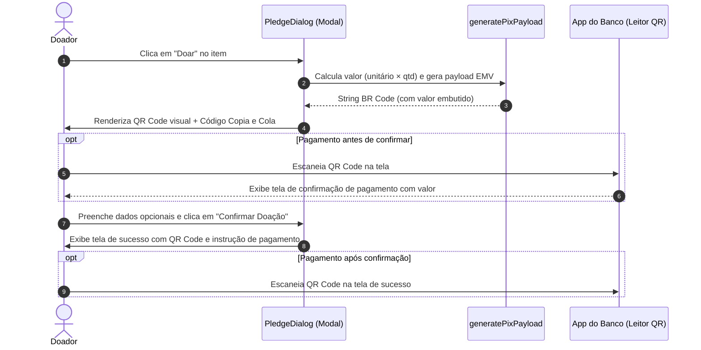

# Plano de Implementação: Geração de QR Code PIX no PledgeDialog

## Descrição do Objetivo
Permitir que os doadores na plataforma Dividi possam escanear um QR Code PIX diretamente a partir de aplicativos bancários (Nubank, Itaú, Bradesco, Banco do Brasil, Inter, Caixa, etc.) ao realizar a intenção de doação de um item no diálogo de doação ([`PledgeDialog`](file:///Users/kallklen/Code/dividi/src/components/pledge-dialog.tsx)).

Atualmente, o diálogo exibe apenas o payload textual "PIX Copia e Cola" dentro de um `<Textarea>` acompanhado de um botão de cópia. Usuários que acessam o site pelo computador, tablet ou outro dispositivo secundário não possuem uma forma de apontar a câmera do celular para efetuar o pagamento.

Com esta funcionalidade:
1. Um QR Code de alto contraste, compatível com a norma EMV QRCPS-MPM (BR Code do Bacen), é gerado dinamicamente para o valor calculado da doação.
2. O QR Code é exibido em tempo real no formulário do modal (conforme a quantidade de itens ou valor avulso é ajustado).
3. O QR Code também é exibido na tela de confirmação de reserva/sucesso para facilitar a conclusão do pagamento imediato.
4. O código "PIX Copia e Cola" e o botão de cópia continuam disponíveis como alternativa.

---

## Decisões de Design Confirmadas

1. **Foco Exclusivo no Diálogo de Doação (`PledgeDialog`)**:
   - O QR Code será gerado e exibido exclusivamente no componente [`PledgeDialog`](file:///Users/kallklen/Code/dividi/src/components/pledge-dialog.tsx).
   - A página principal da campanha ([`/campaigns/[id]`](file:///Users/kallklen/Code/dividi/src/app/campaigns/%5Bid%5D/page.tsx)) permanece inalterada em seu bloco de informações gerais de PIX.
2. **Biblioteca de Renderização**:
   - Utilização do `react-qr-code` (`^2.2.0`), pacote já presente no `pnpm-lock.yaml` do projeto (utilizado como dependência transitiva do Neon Auth UI).
   - Renderização via SVG puro: alta nitidez em qualquer densidade de pixels, sem dependência de APIs de Canvas e totalmente compatível com React 19.
3. **Contraste Óptico e Modo Escuro**:
   - O QR Code será envolvido em um contêiner branco dedicado com padding adequado (`bg-white p-3.5 rounded-xl border border-border shadow-xs`) para manter a zona de silêncio (quiet zone) indispensável para a leitura pelas câmeras dos smartphones, inclusive quando o usuário estiver usando tema escuro.
4. **Valor Embutido (Tag 54)**:
   - O QR Code contém o valor exato da doação (preço unitário × quantidade ou valor customizado definido pelo doador), preenchendo automaticamente o valor no app do banco.

---

## Mudanças Propostas

### 1. Dependências do Projeto

#### [MODIFY] `package.json`
- Adicionar `"react-qr-code": "^2.2.0"` na seção `dependencies`.

```json
  "dependencies": {
    ...
    "react-hook-form": "^7.88.0",
    "react-qr-code": "^2.2.0",
    "tailwind-merge": "^3.7.0",
    ...
  }
```

---

### 2. Componente de Interface do QR Code PIX

#### [NEW] `src/components/pix-qr-code.tsx`
- Componente `'use client'` para encapsular a renderização do SVG do QR Code:
  - **Props**:
    - `value: string`: Payload EMV BR Code gerado por `generatePixPayload`.
    - `size?: number`: Tamanho em pixels (padrão: 160).
    - `className?: string`: Estilização adicional opcional.
  - **Recursos**:
    - Fundo branco de alto contraste (`bg-white p-3.5 rounded-xl border border-border shadow-xs inline-flex items-center justify-center`).
    - Nível de correção de erros `level="M"`.
    - Atributos de acessibilidade: `role="img"` e `aria-label="QR Code PIX para pagamento"`.

#### [NEW] `src/components/pix-qr-code.test.tsx`
- Testes unitários para validar renderização do SVG, presença do payload no elemento e acessibilidade.

---

### 3. Integração no Diálogo de Doação

#### [MODIFY] `src/components/pledge-dialog.tsx`
- Importar e renderizar `<PixQRCode />` nos dois momentos do fluxo PIX:
  1. **No formulário de doação** (quando `watchedDonationType === 'pix'` e `pixCode` estiver disponível):
     - Exibir o QR Code centralizado com instruções em `pt-BR`: *"Aponte a câmera do aplicativo do seu banco para o QR Code acima"*.
     - Manter o campo de texto "PIX Copia e Cola" e o botão "Copiar Código PIX" como opção logo abaixo.
  2. **Na tela de confirmação de reserva / sucesso** (`isSuccess === true` e `watchedDonationType === 'pix'`):
     - Exibir o QR Code junto com o valor confirmado e o botão de cópia do código PIX.

#### [MODIFY] `src/components/pledge-dialog.test.tsx`
- Adicionar verificações nos testes existentes:
  - Conferir a presença do elemento com `aria-label="QR Code PIX para pagamento"`.
  - Garantir que a alteração de quantidade atualiza o QR Code dinamicamente.
  - Garantir que na tela de sucesso pós-confirmação o QR Code também é exibido.

---

## Diagrama do Fluxo no Diálogo



---

## Plano de Verificação

### Testes Automatizados
```bash
pnpm check:all
# ou testes unitários específicos:
pnpm test src/components/pledge-dialog.test.tsx src/components/pix-qr-code.test.tsx
```

### Verificação Manual
1. Iniciar servidor de desenvolvimento: `pnpm dev`.
2. Acessar uma campanha ativa em `http://localhost:3000/campaigns/[id]`.
3. Clicar no botão "Doar" em um item da lista:
   - Verificar se o modal abre exibindo o QR Code nítido, centralizado sobre fundo branco.
   - Alterar a quantidade do item (ex: de 1 para 3): verificar se o QR Code se atualiza instantaneamente com o novo valor total.
   - Testar o botão "Copiar Código PIX" e verificar o feedback "Copiado!".
   - Escanear o QR Code exibido com a câmera de um smartphone com aplicativo de banco para atestar a leitura correta do recebedor e do valor.
4. Preencher dados e clicar em "Confirmar Doação":
   - Verificar se a tela de sucesso ("Doação registrada com sucesso!") exibe o QR Code e o botão Copia e Cola correspondente.
